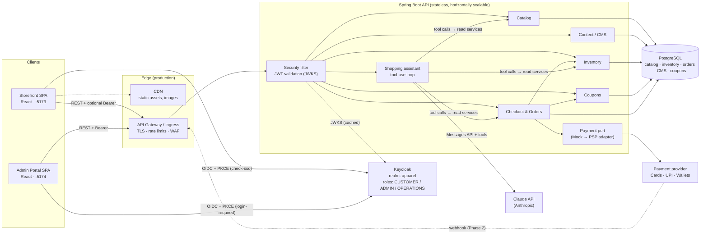
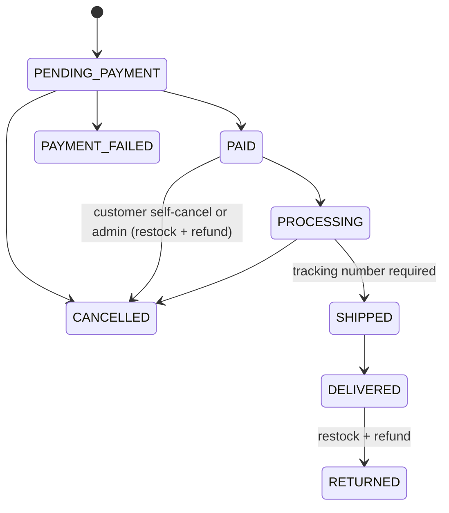
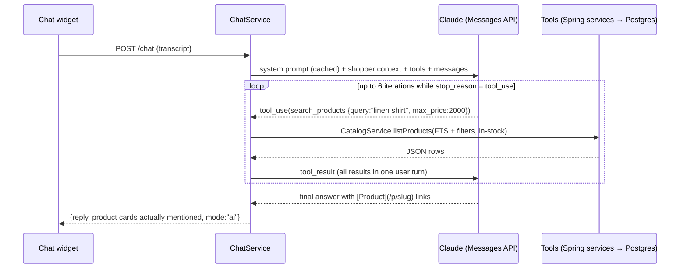

# Loom & Co. — B2C Apparel Commerce Platform: Architecture & Delivery Plan

This document covers the five deliverables. Everything marked **(implemented)** exists in this repository and builds today.

| Layer | Technology | Location |
|---|---|---|
| API | Java 21, Spring Boot 3.5, Spring Data JPA, Flyway | [`backend/`](../backend) |
| Storefront | React 18 + TypeScript + Vite | [`storefront/`](../storefront) |
| Admin portal | React 18 + TypeScript + Vite | [`admin/`](../admin) |
| Database | PostgreSQL 16 | [`V1__init_schema.sql`](../backend/src/main/resources/db/migration/V1__init_schema.sql) |
| Identity | Keycloak 26 (OIDC, PKCE) | [`infra/keycloak/apparel-realm.json`](../infra/keycloak/apparel-realm.json) |
| AI assistant | Claude Messages API with tool use (Anthropic Java SDK) | [`backend/.../chat`](../backend/src/main/java/com/apparel/commerce/chat) |

---

## 1. Data model and schema design

### 1.1 Entity-relationship diagram

```mermaid
erDiagram
    CATEGORY ||--o{ CATEGORY : "parent of"
    CATEGORY ||--o{ PRODUCT : contains
    SIZE_CHART ||--o{ PRODUCT : "sizes"
    PRODUCT ||--o{ PRODUCT_VARIANT : "has SKUs"
    PRODUCT ||--o{ PRODUCT_IMAGE : gallery
    PRODUCT_VARIANT ||--|| INVENTORY : "stock ledger"
    PRODUCT_VARIANT ||--o{ INVENTORY_MOVEMENT : audit
    CATEGORY ||--o{ NAVIGATION_ITEM : "linked from"
    NAVIGATION_ITEM ||--o{ NAVIGATION_ITEM : children
    ORDERS ||--|{ ORDER_ITEM : lines
    ORDERS ||--o{ ORDER_STATUS_HISTORY : timeline
    ORDERS ||--o{ PAYMENT : attempts
    COUPON ||--o{ COUPON_REDEMPTION : redeemed
    ORDERS ||--o| COUPON_REDEMPTION : uses
    PRODUCT_VARIANT ||--o{ ORDER_ITEM : "sold as"

    CATEGORY { bigint id PK; bigint parent_id FK; varchar slug UK; varchar visibility "ENABLED|DISABLED|HIDDEN"; int sort_order }
    PRODUCT { bigint id PK; bigint category_id FK; varchar slug UK; numeric base_price; numeric compare_at_price; varchar status "DRAFT|ACTIVE|ARCHIVED"; int popularity_score; varchar marketing_badge; tsvector search_vector "generated" }
    PRODUCT_VARIANT { bigint id PK; bigint product_id FK; varchar sku UK; varchar size; varchar color; numeric price_override; bool active }
    INVENTORY { bigint variant_id PK; int on_hand; int reserved; int low_stock_threshold; bigint version }
    INVENTORY_MOVEMENT { bigint id PK; bigint variant_id FK; int delta; varchar reason; varchar reference; varchar created_by }
    BANNER { bigint id PK; varchar placement "HOME_HERO|HOME_STRIP|PLP_TOP|PDP_PROMO"; timestamptz starts_at; timestamptz ends_at; bool active }
    HOME_SECTION { bigint id PK; varchar section_type; jsonb config; int sort_order; bool active }
    NAVIGATION_ITEM { bigint id PK; bigint parent_id FK; varchar link_type; bigint category_id FK; varchar visibility }
    COUPON { bigint id PK; varchar code UK; varchar discount_type; numeric discount_value; numeric max_discount_amount; numeric min_cart_value; varchar target_user_type "ALL|GUEST|REGISTERED"; int usage_limit_total; int usage_limit_per_user; int times_used }
    COUPON_REDEMPTION { bigint id PK; bigint coupon_id FK; bigint order_id FK; varchar customer_id; varchar email }
    ORDERS { bigint id PK; varchar order_number UK; varchar customer_id "Keycloak sub, null for guest"; varchar email; varchar status; numeric grand_total; varchar ship_city "address snapshot cols"; varchar bill_city "address snapshot cols" }
    ORDER_ITEM { bigint id PK; bigint order_id FK; bigint variant_id FK; varchar sku; varchar product_name; numeric unit_price; int quantity }
    PAYMENT { bigint id PK; bigint order_id FK; varchar method "CREDIT_CARD|DEBIT_CARD|WALLET|UPI"; varchar provider_ref; varchar instrument "masked"; varchar status }
```

`customer_address` (the saved address book) and `size_chart` complete the schema; see `V1__init_schema.sql`.

### 1.2 Key design decisions

| Decision | Rationale |
|---|---|
| **Product → Variant (SKU) → Inventory** as three tables | Apparel sells by size × colour. Price lives on the product and can be overridden per variant. Stock is per SKU. |
| `inventory.on_hand` + `reserved` and **conditional UPDATEs** | `UPDATE … SET reserved = reserved + :q WHERE on_hand - reserved >= :q` is atomic, so two shoppers can't buy the last unit. Locks are taken in sorted variant-id order to avoid deadlocks. |
| `inventory_movement` append-only ledger | Every stock change records who made it and why (restock, sale, return, damage). Stock levels can be audited and reconciled. |
| Order **snapshots** of names, prices, and addresses | Editing the catalog or an address book never changes order history. |
| `customer_id` = Keycloak `sub`, no customer table | Keycloak is the source of truth for identity and PII such as name and password. Commerce data joins on the subject ID only. |
| Visibility enum `ENABLED / DISABLED / HIDDEN` | One rule set for categories and menu items. DISABLED renders a greyed-out "coming soon" entry, which is useful for teasing launches. |
| `home_section.config` as JSONB | New homepage block types need no migration. The API resolves each section's data, so the homepage loads in one call. |
| Generated `tsvector` + GIN index | Full-text search in Postgres for the PLP and the chatbot, with no extra infrastructure in phases 1–3. |
| Money as `NUMERIC(12,2)`, prices GST-inclusive | No float rounding. Indian B2C display convention. |
| Enums as `VARCHAR + CHECK` | Portable and JPA-friendly. Adding a value is a one-line migration. |
| Flyway owns the schema (`ddl-auto: none`) | Migrations are reviewed and versioned. Hibernate never mutates the schema. |

---

## 2. System architecture and data flow



### 2.1 Authentication and authorization (implemented)

| Actor | Keycloak client | Flow | API access |
|---|---|---|---|
| Guest shopper | `storefront` (public, PKCE) | none (check-sso finds no session) | `GET /catalog/**`, `GET /content/**`, `/checkout/**`, `/coupons/validate`, `/orders/track`, `/chat` |
| Registered customer | `storefront` | Authorization Code + PKCE | The above, plus `/me/**`. Checkout attaches the order to the `sub`. |
| Admin | `admin-portal` (public, PKCE) | login-required | `/admin/**`: everything |
| Operations | `admin-portal` | login-required | `/admin/orders`, `/admin/inventory`, read-only catalog. CMS and coupon writes return 403 (`@PreAuthorize("hasRole('ADMIN')")`). |

- The API is a stateless OAuth2 resource server. It validates the signature against Keycloak's JWKS and validates `iss`. Realm roles in `realm_access.roles` map to `ROLE_*` authorities.
- Self-registered users get `CUSTOMER` through the realm's `default-roles-apparel` composite.
- The public storefront endpoints still parse a bearer token when one is present. That is how one checkout endpoint serves both guests and members, and how member-only coupons are enforced.

### 2.2 Checkout sequence (implemented)

```mermaid
sequenceDiagram
    autonumber
    participant SF as Storefront
    participant API as CheckoutService
    participant DB as PostgreSQL
    participant PSP as PaymentGateway
    SF->>API: POST /checkout/orders {items, coupon, addresses, payment token, idempotencyKey}
    API->>DB: re-price (variants, product status, live stock) + evaluate coupon
    API->>DB: UPDATE inventory SET reserved += q WHERE available >= q (per SKU, sorted)
    alt any SKU short
        API-->>SF: 409 OUT_OF_STOCK (transaction rolled back)
    end
    API->>DB: INSERT order (PENDING_PAYMENT) + items + history
    API->>DB: UPDATE coupon SET times_used += 1 WHERE under cap; INSERT redemption
    API->>PSP: charge(orderNumber, amount, token | UPI VPA | wallet)
    alt success
        API->>DB: on_hand -= q, reserved -= q (SALE); order → PAID; payment SUCCEEDED
    else declined
        API->>DB: reserved -= q (RELEASE); revoke coupon; order → PAYMENT_FAILED
    end
    API-->>SF: 201 OrderView
```

Phase 2 makes payment asynchronous: create intent → client confirms (3-DS or UPI collect) → PSP webhook → the same success or failure branch. A scheduled job then releases reservations on orders stuck in `PENDING_PAYMENT` for more than 15 minutes.

### 2.3 Order state machine (implemented in `OrderStatus`)



---

## 3. API contract summary

Base path `/api/v1`. JSON throughout. Errors are RFC 7807 `ProblemDetail` with a stable `code`, for example `OUT_OF_STOCK`, `COUPON_EXPIRED`, `INVALID_TRANSITION`. OpenAPI is served at `/swagger-ui.html`.

### 3.1 Storefront (public; bearer token optional)

| Method | Path | Purpose |
|---|---|---|
| GET | `/content/home` | Ordered homepage sections, each resolved with its banners, products, or categories |
| GET | `/content/navigation` | Mega-menu tree (HIDDEN items removed; DISABLED items flagged) |
| GET | `/content/banners?placement=PLP_TOP` | Live banners for a slot (active and within schedule) |
| GET | `/catalog/categories` · `/catalog/categories/{slug}` | Category tree / one category with its children |
| GET | `/catalog/products?category=&q=&size=&color=&minPrice=&maxPrice=&inStock=&sort=newest\|price_asc\|price_desc\|popularity&page=&pageSize=` | PLP: paged `ProductCard`s with `inStock` / `lowStock` badges |
| GET | `/catalog/products/{slug}` | PDP: images, variants with `stockStatus`, size chart, marketing HTML, breadcrumbs |
| GET | `/catalog/facets?category=` | Available sizes and colours for filters |
| POST | `/checkout/quote` | Server-side price of a cart: lines, issues, coupon evaluation, shipping, total |
| POST | `/coupons/validate` | `{code, items, email}` → `{applied, discount, reasonCode, message}` |
| POST | `/checkout/orders` | Place an order (guest or member). Body: `{items[], couponCode, email, shippingAddress, billingAddress, billingSameAsShipping, payment:{method, token\|upiId\|walletProvider}, idempotencyKey}` |
| GET | `/orders/track?orderNumber=&email=` | Guest order lookup |
| POST | `/chat` | `{messages:[{role, content}]}` → `{reply, products[], mode}` |

### 3.2 Customer (`CUSTOMER` token required)

| Method | Path | Purpose |
|---|---|---|
| GET | `/me` | Profile claims |
| GET | `/me/orders` · `/me/orders/{orderNumber}` | Order history / detail |
| POST | `/me/orders/{orderNumber}/cancel` | Self-cancel while `PAID` |
| GET/POST/PUT/DELETE | `/me/addresses[/{id}]` | Address book (max 10, one default) |

### 3.3 Admin (`ADMIN`; `OPERATIONS` where noted)

| Method | Path | Roles |
|---|---|---|
| GET | `/admin/dashboard` | ADMIN, OPS |
| GET, POST · PUT, DELETE | `/admin/categories` · `/admin/categories/{id}` | read: both · write: ADMIN |
| PATCH | `/admin/categories/{id}/visibility` `{visibility}` | ADMIN |
| GET, POST · GET, PUT, DELETE (archive) | `/admin/products` · `/admin/products/{id}` | read: both · write: ADMIN |
| POST · PUT | `/admin/products/{id}/variants` · `/admin/products/{id}/variants/{variantId}` | ADMIN |
| POST · DELETE | `/admin/products/{id}/images` · `/admin/products/{id}/images/{imageId}` | ADMIN |
| GET | `/admin/inventory?q=&lowStockOnly=` | ADMIN, OPS |
| POST | `/admin/inventory/{variantId}/adjustments` `{delta, reason, note, lowStockThreshold}` | ADMIN, OPS |
| GET | `/admin/inventory/{variantId}/movements` | ADMIN, OPS |
| GET, POST · PUT, DELETE | `/admin/content/banners[/{id}]` | ADMIN |
| GET, POST · PUT, DELETE · PUT | `/admin/content/home-sections[/{id}]` · `/home-sections/order` | ADMIN |
| GET, POST · PUT, DELETE · PATCH | `/admin/content/navigation[/{id}]` · `/{id}/visibility` | ADMIN |
| GET, POST · GET, PUT, DELETE | `/admin/coupons[/{id}]` | ADMIN |
| PATCH · GET | `/admin/coupons/{id}/active` · `/admin/coupons/{id}/redemptions` | ADMIN |
| GET · GET | `/admin/orders?status=&q=` · `/admin/orders/{orderNumber}` | ADMIN, OPS |
| PATCH | `/admin/orders/{orderNumber}/status` `{status, note, trackingNumber}` | ADMIN, OPS |

### 3.4 Coupon rules (implemented in `CouponRules`, unit-tested)

The rules are evaluated in this order. The first failure becomes the shopper-facing message.

`active` → `starts_at ≤ now < ends_at` → target user type (GUEST vs REGISTERED) → `subtotal ≥ min_cart_value` → `times_used < usage_limit_total` → per-shopper uses < `usage_limit_per_user` (keyed by `sub` for members, email for guests).

The discount is `PERCENTAGE` (capped by `max_discount_amount`) or `FIXED_AMOUNT`, and never exceeds the subtotal. When the coupon is redeemed, an atomic conditional update enforces the global cap under concurrency.

---

## 4. AI chatbot integration strategy

### 4.1 Recommended pattern: agentic retrieval over live data, with semantic search added later

Classic RAG embeds the catalog into a vector store and pastes the top-k chunks into the prompt. Three properties of commerce data make that a poor primary design:

1. **Freshness.** Prices, stock, and order status change by the minute, and a vector index is always behind.
2. **Precision.** "Black, size M, under ₹1500, in stock" is a structured filter. Similarity search answers it badly.
3. **Authorization.** Order status must be scoped to the caller, which a shared index can't express.

So the assistant (**implemented** in `ChatService` and `ShoppingAssistantTools`) uses Claude tool use. The model decides which tool to call. The tools call the same read services the storefront uses, so answers are always live and access-controlled.



| Tool | Backed by | Guardrail |
|---|---|---|
| `search_products` | Postgres FTS (`websearch_to_tsquery` on the generated `tsvector`) plus PLP filters | ACTIVE products only; in-stock by default; max 6 results |
| `get_product_details` | `CatalogService.product` | Exact stock counts capped at 10; never exposes cost or inactive SKUs |
| `recommend_size` | Deterministic matching against the product's size chart | The model explains the result but doesn't do the arithmetic |
| `get_order_status` | `OrderService.lookup*` | Members see only their own orders (`sub`). Guests need order number **and** email. A mismatch never reveals that the order exists. |
| `list_categories` | Category tree | Hidden categories excluded |

**Model and API settings:**
- Model `claude-opus-5-5` (configurable through `CHAT_MODEL`).
- `effort: low`, because chat turns are short and tool-driven.
- The stable system prompt carries a cache breakpoint; per-request context comes after it.
- Server-side refusal fallback is enabled (`fallbacks: "default"`).
- `stop_reason` is checked on every turn: `refusal`, `max_tokens`, and `tool_use` are handled.

**Safety:**
- Tool results are framed as data, not instructions.
- The widget renders only plain text and internal links, never raw model HTML.
- Per-IP rate limit of 20 requests per minute.
- Transcripts are capped at 20 messages and 2,000 characters per message.

**Degraded mode:** With no `ANTHROPIC_API_KEY`, or on API errors or rate limits, `/chat` falls back to a keyword search and still returns product cards. The storefront never breaks because of the assistant.

### 4.2 Phase 4 extension: hybrid semantic search with pgvector

Some queries have no keyword overlap with the catalog ("something breezy for a beach wedding"). For those, add semantic recall without giving up live data:

1. Enable the `pgvector` extension and add `product_embedding(product_id PK, embedding vector(1024), content_hash, updated_at)`.
2. Embed `name + description + material + category path + attributes` with an embedding model. Claude doesn't produce embeddings, so pick a dedicated provider.
3. Keep it fresh with a transactional outbox: product upsert → outbox row → async worker re-embeds when `content_hash` changes.
4. In `search_products`, run FTS and vector KNN (`ORDER BY embedding <=> :q LIMIT 50`), merge them with reciprocal-rank fusion, **then** apply the live SQL filters (stock, price, size) on the candidate IDs. The vector index finds candidates; Postgres stays the source of truth.
5. Optionally embed policy and FAQ pages into a separate `kb_chunk` table behind a `search_help_articles` tool, which is classic RAG for static content.

Spring AI's `PgVectorStore` is a reasonable choice for steps 1–4 if you want its abstractions. The Claude call itself stays on the official Anthropic Java SDK.

### 4.3 Quality and operations

- **Eval set:** about 100 real or synthetic shopper questions with expected tool calls and graded answers. Run it in CI when prompts, tools, or models change.
- **Telemetry:** log the tool-call sequence, latency, token usage, and cache-hit tokens per turn. Alert on refusal rate and error rate.
- **Human handoff:** escalate to support (email or helpdesk ticket containing the transcript) for refunds, complaints, and repeated failures.

---

## 5. Phased development roadmap

Assumes one squad of about 2 backend, 2 frontend, 1 QA, and 0.5 DevOps working in 2-week sprints. ✅ marks work that already exists in this repository.

### Phase 1: Foundation (sprints 1–3, ~6 weeks)

**Goal:** a walking skeleton deployed to a dev environment with auth end-to-end.

| Stream | Scope |
|---|---|
| Platform | ✅ Monorepo, ✅ docker-compose (Postgres, Keycloak), ✅ backend Dockerfile, CI (build, unit tests, OWASP dependency check, image push), dev/staging environments (managed Postgres, Keycloak with HA DB), secrets in a vault |
| Identity | ✅ Realm with 3 roles and 2 PKCE clients, ✅ JWT resource server and role mapping, ✅ default CUSTOMER role on signup. Then: email verification, branded login theme, social login (Google), MFA for ADMIN |
| Data | ✅ Flyway baseline schema and seed data, naming and money conventions |
| API standards | ✅ ProblemDetail errors with codes, ✅ pagination envelope, ✅ OpenAPI, ✅ CORS. Then: correlation IDs, structured JSON logs, Actuator and Micrometer metrics |
| Frontends | ✅ Both SPAs scaffolded with Keycloak, routing, and API client |

**Exit criteria:** a user registers, signs in, calls `/me`; an admin reaches the portal while a customer gets 403; the pipeline deploys to staging on merge.

### Phase 2: Core e-commerce and inventory (sprints 4–8, ~10 weeks)

**Goal:** a shopper can find, buy, and track a product, and inventory is correct under concurrency.

| Stream | Scope |
|---|---|
| Catalog | ✅ Category tree, ✅ PLP filters, sort, and pagination with stock badges, ✅ PDP with variants, size chart, and gallery, ✅ FTS search, ✅ facets. Then: SEO (SSR or prerender for PLP/PDP, sitemap, structured data), image CDN with responsive sizes |
| Cart and checkout | ✅ Client cart with server re-pricing (`/quote`), ✅ guest and member checkout, ✅ shipping and billing addresses, ✅ address book, ✅ idempotent order placement |
| Inventory | ✅ Atomic reserve, commit, and release, ✅ movement ledger, ✅ restock on cancel and return. Then: reservation expiry job for abandoned `PENDING_PAYMENT`, nightly reconciliation report |
| Payments | ✅ `PaymentGateway` port and mock for Card, UPI, and Wallet. Then: real PSP adapter (for example Razorpay or Stripe India) with hosted card fields, UPI intent and collect, wallets, **async webhooks** with signature verification, refunds, and a payment-reconciliation job |
| Orders | ✅ State machine, ✅ history, ✅ My Orders, ✅ guest tracking, ✅ self-cancel. Then: transactional email and SMS (order placed, shipped, delivered) via an outbox |
| Quality | Testcontainers integration tests for checkout races (N concurrent buyers, 1 unit); k6 load test at the target of about 50 checkouts/s |

**Exit criteria:** end-to-end purchase on staging with sandbox PSP payments; zero oversell in the concurrency test; p95 PLP under 300 ms.

### Phase 3: Admin CMS and promotions (sprints 9–12, ~8 weeks)

**Goal:** the business team runs merchandising and promotions without engineers.

| Stream | Scope |
|---|---|
| Catalog admin | ✅ Category CRUD and visibility, ✅ product, variant, and image CRUD, ✅ archive. Then: image upload through pre-signed URLs, CSV bulk import and export, product duplication, draft preview links |
| CMS | ✅ Banners with placements and schedules, ✅ homepage section builder (reorder, toggle, JSON config), ✅ mega-menu editor with Enable/Disable/Hide. Then: visual config forms per section type, content versioning and rollback, cache purge on publish |
| Promotions | ✅ Coupon engine (percentage or fixed, minimum cart, user targeting, validity, global and per-user caps), ✅ redemption log. Then: category or product-scoped coupons, bulk unique-code generation, automatic cart promotions (BOGO, tiered), stacking rules |
| Operations | ✅ Dashboard KPIs, ✅ order list, search, and status workflow, ✅ inventory adjustments. Then: pick lists and packing slips, carrier integration (AWB generation, tracking webhooks), RMA and returns workflow, audit-log viewer, low-stock email alerts |
| Governance | Fine-grained permissions (for example a merchandiser role), admin action audit trail, 4-eyes approval for large discounts |

**Exit criteria:** merchandisers launch a campaign (banner, homepage rail, coupon, menu teaser) end-to-end in staging; ops ship and return orders without database access.

### Phase 4: Advanced features and chatbot (sprints 13–16, ~8 weeks)

**Goal:** differentiation through the AI assistant, personalization, and scale.

| Stream | Scope |
|---|---|
| AI assistant | ✅ Claude tool-use assistant (search, details, size advice, order status), ✅ offline fallback, ✅ rate limit. Then: pgvector hybrid search (section 4.2), help-center RAG, streaming responses (SSE), multilingual support (Hindi and others), human handoff, eval suite in CI, cost and latency dashboards |
| Discovery | Dedicated search engine (OpenSearch) if the catalog exceeds about 50k SKUs, synonyms and typo tolerance, "complete the look" and recently viewed |
| Personalization | Wishlist, back-in-stock alerts, personalized homepage rails |
| Scale and resilience | Redis for content caching, rate limiting, and idempotency keys; read replica for catalog reads; CDN edge caching of `/content/*`; chaos and DR drills (RPO 15 min, RTO 1 h) |
| Compliance | DPDP Act consent and data-export/delete flows, PCI SAQ-A attestation (hosted fields), accessibility audit (WCAG 2.2 AA), pen test |

**Exit criteria:** at least 70% of assistant conversations resolve without handoff on the eval set; search conversion uplift measured through an A/B test; production launch readiness review passed.

---

## 6. Production hardening checklist (cross-phase)

- The in-memory idempotency map and per-IP chat limiter are **single-node**. Move both to Redis or a DB unique constraint before running more than one replica.
- Run the API behind a gateway with TLS, WAF, and request-size limits. Set `server.forward-headers-strategy=framework` so client IPs are correct.
- Move seed data (`V2__seed_data.sql`) to a dev-only Flyway location.
- Back up Postgres with point-in-time recovery. Keep Keycloak's database separate from commerce data in production.
- Keep secrets (DB, Anthropic API key, PSP keys) in a secrets manager, never in images or `.env` files.
